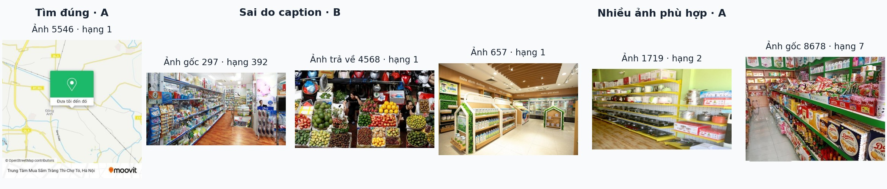

# Recall tìm ảnh KTVIC trên tập test

Trên **558 ảnh test và 2.790 truy vấn mỗi chỉ mục**, A đạt **12,90% ở Recall@5**, so với **10,25% của B**. Ở top 1, B trúng 108 lượt và A trúng 107 lượt.

## Giao thức

- Mỗi chỉ mục chứa một caption tự sinh cho từng ảnh test, từ checkpoint A hoặc B Kaggle seed 42 đã khóa. Năm câu tham chiếu của một ảnh là năm truy vấn riêng, cùng lấy ID ảnh gốc làm đáp án. [Danh sách phiên bản](Danh_sách_phiên_bản_test_và_demo_KTVIC.md)
- Dùng lại quy trình val. IDF học từ **16.895 caption train**, với 1.712 âm tiết trong từ vựng. Vector TF-IDF được chuẩn hóa L2. Xếp đủ 558 ứng viên theo cosine giảm dần và theo ID ảnh tăng dần khi hòa điểm. Truy vấn toàn từ ngoài từ vựng được tính là không trúng. Cả hai chỉ mục đều có 0 truy vấn thuộc trường hợp này. [Giao thức val](Báo_cáo_Recall_tìm_ảnh_A_và_B.md)

## Kết quả

| Chỉ mục | Recall@1 | Recall@5 | Recall@10 | Hạng trung vị |
|---|---:|---:|---:|---:|
| A | 3,84% (107/2.790) | **12,90% (360/2.790)** | **19,39% (541/2.790)** | 71 |
| B | **3,87% (108/2.790)** | 10,25% (286/2.790) | 16,70% (466/2.790) | 77 |
| Xếp ngẫu nhiên | 0,18% | 0,90% | 1,79% | |

Chênh lệch A − B ở R@5 là **+2,65 điểm phần trăm** (KTC 95% từ +0,25 đến +4,84). Ở R@1, khoảng từ −1,58 đến +1,47. Ở R@10, khoảng từ 0,00 đến +5,23. Các khoảng được tính từ 2.000 lượt lấy mẫu lại theo ảnh, giữ năm truy vấn của mỗi ảnh cùng nhau. Kết quả đo trên một checkpoint cho mỗi mô hình.

## Ba ca minh họa



| Ca | Câu truy vấn | Kết quả và đối chiếu ảnh |
|---|---|---|
| **Tìm đúng · A** | “đây là một bức ảnh chụp một tấm bản đồ” | Ảnh **5546** đứng **hạng 1**, cosine **0,7822**. Ảnh là bản đồ và caption sinh giữ cụm “tấm bản đồ”. |
| **Sai do caption · B** | “có nhiều loại hàng hoá được bày ra trên các kệ hàng” | Ảnh gốc **297** xuống **hạng 392**, cosine **0,0134**. Caption B thêm người và bỏ chi tiết kệ hàng. Ảnh **4568** đứng đầu (0,6941) vì caption của nó nhắc tới quả bày trên các kệ hàng. |
| **Nhiều ảnh phù hợp · A** | “ở trên các kệ hàng có sự xuất hiện của nhiều loại hàng hoá” | **Bảy ảnh** có cùng caption và cùng cosine **0,8789**. Ảnh **657** và **1719** cũng có hàng hóa trên kệ. Ảnh gốc **8678** đứng **hạng 7** theo quy tắc ID, nên trượt R@5 dù phù hợp với truy vấn. |

Mỗi truy vấn chỉ có một ID đáp án trong benchmark. Ca thứ ba cho thấy hạng theo ID và mức phù hợp với mô tả có thể khác nhau. [Truy vấn, ID, caption, điểm và hạng đã lưu](retrieval_test/ca_minh_hoa.json)

## Chạy lại và đối chiếu

Từ gốc repo, dùng hai file dự đoán test trong bảng điểm đã duyệt. Lượt kiểm tra dùng Python 3.13.7, NumPy 2.4.4 và OpenBLAS một luồng.

```powershell
$env:OPENBLAS_NUM_THREADS = '1'
python -m scripts.evaluate_caption_retrieval --split test --predictions-a reports/test_results/A_test_predictions.json --predictions-b reports/test_results/B_test_predictions.json
```

- Lệnh lưu `ranks_A.csv`, `ranks_B.csv` và `recall_summary.json` trong `runs/retrieval_test_eval/`. Hai chỉ mục `ktvic_a_test.npz` và `ktvic_b_test.npz` nằm trong `artifacts/retrieval/recall_eval/`.
- Đã xác nhận hai chỉ mục chứa đủ ID test và có cùng từ vựng, IDF với chỉ mục val. Chạy lại test cho hai CSV và JSON khớp từng byte. Chạy lại lệnh val cũ cũng khớp. **80 kiểm thử đạt**.
