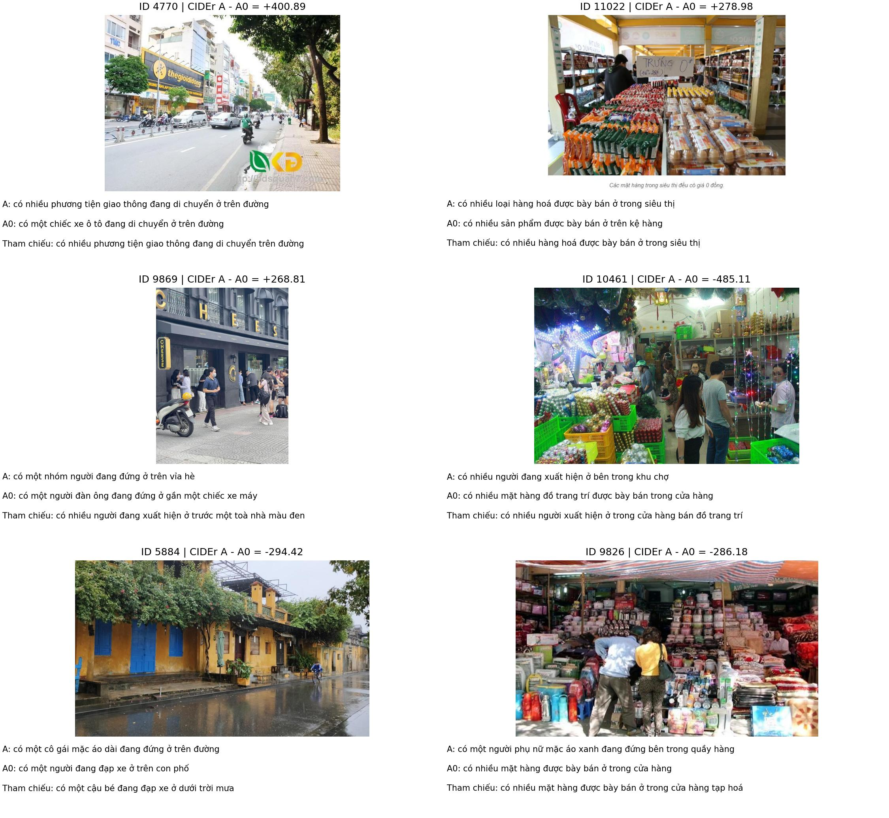

# Báo cáo đối chứng A0

**Phụ trách** Vanh · **Cập nhật** 18/11/2026 · **Nhánh** `lstm-attention`.

## Thiết lập

A0 dùng `configs/lstm_attention_uniform.yaml`. Ở mỗi bước, cả 49 vùng nhận trọng số **1/49**, nên LSTM nhận trung bình các vùng đã chiếu. A0 được huấn luyện lại từ đầu với cùng cấu trúc và khởi tạo như A. Lớp tính điểm attention vẫn có trong checkpoint để giữ cách khởi tạo, còn nhánh sinh câu của A0 dùng trọng số cố định.

Hai lượt đều dùng Tesla T4, PyTorch 2.11.0+cu130, cấu hình `d_model=512`, `hidden_size=1120`, `attention_size=512`, dropout 0,1. Cùng split, cache ResNet-50, từ vựng, seed 42, batch 32, AdamW với LR 0,0003 và weight decay 0,01. Tối đa 20 epoch, dừng sớm sau 4 epoch không cải thiện CIDEr val, giải mã greedy tối đa 40 token.

## Kết quả trên 375 ảnh val

Mỗi ảnh có một câu dự đoán và năm câu tham chiếu. Bảng dùng `pycocoevalcap` 1.2, thang ×100. Cột cuối là **A trừ A0**.

| Chỉ số | A | A0 | A − A0 |
|---|---:|---:|---:|
| BLEU-1 | 63,29 | 63,59 | −0,30 |
| BLEU-2 | 49,20 | 49,55 | −0,35 |
| BLEU-3 | 38,06 | 38,35 | −0,29 |
| BLEU-4 | 30,17 | 30,13 | +0,04 |
| **CIDEr-D** | **76,96** | **77,95** | **−0,99** |

A0 đạt điểm CIDEr cao nhất ở **epoch 6** và dừng ở epoch 10. A chọn epoch 5 và dừng ở epoch 9. Lượt A0 mất khoảng **6 phút 31 giây** theo `runtime.json`, gồm kiểm thử, chạy thử, huấn luyện và xuất kết quả. Thời gian chờ GPU nằm ngoài số đo này. Train loss của A0 giảm từ 2,7092 ở epoch 1 xuống 0,8295 ở epoch 10. Val loss là 1,7606 ở epoch 6 và tăng lên 1,8408 ở epoch 10.

A0 cao hơn A 0,99 điểm CIDEr-D, còn A cao hơn 0,04 điểm BLEU-4. Chênh lệch điểm toàn tập nhỏ dù **351/375 caption thay đổi**. Kết quả hiện dựa trên một seed và tập val, nên chưa đủ để kết luận mô hình nào tốt hơn nói chung.

## Ảnh minh họa

- **ID 4770.** A tả nhiều phương tiện, bao quát cả ô tô và xe máy. A0 chỉ nhắc một ô tô.
- **ID 5884.** A tả cô gái mặc áo dài đứng trên đường. A0 nhận ra người đang đạp xe, phù hợp với ảnh.
- **ID 10461.** A nói chung về người trong chợ. A0 nhận ra mặt hàng trang trí, là chi tiết rõ trong ảnh và có trong nhiều câu tham chiếu.

Hình lấy ba ảnh có chênh CIDEr theo ảnh lớn nhất nghiêng về mỗi mô hình trong số các caption đã đổi. Các ví dụ minh họa cách nội dung thay đổi trên từng ảnh.

## Kiểm tra và bàn giao

`scripts/compare_caption_models.py` kiểm tra cấu hình, thiết lập và chữ ký dữ liệu của hai lượt, rồi chấm lại cùng 375 ảnh và 1.875 tham chiếu. `scripts/plot_caption_comparison.py` dựng hình từ `comparison.json` và ảnh gốc.

Điểm chấm lại trên máy khớp Kaggle. Nạp `best.pt` và sinh lại cho kết quả khớp **375/375 caption**. Tất cả câu kết thúc bằng EOS. Trên 4.860 bước sinh, cả 49 trọng số đều bằng 1/49 và tổng bằng 1. Đọc được cả hai checkpoint cùng trạng thái optimizer. Bộ kiểm thử nhánh đạt **50/50**.

Checkpoint `best.pt` (epoch 6), `last.pt` (epoch 10), `val_predictions.json`, `metrics.json`, `runtime.json`, `history.json`, `loss_curve.png` và `comparison.json` có trong [output Kaggle A0](https://www.kaggle.com/code/wann179/ktvic-a0-uniform-20261117/output). Bản tải về nằm ở `runs/a0_kaggle/project/runs/a0_uniform/`.

Phần tìm ảnh đã hoàn thành và được tách thành [báo cáo TF-IDF riêng](Báo_cáo_tìm_ảnh_TF_IDF.md).
