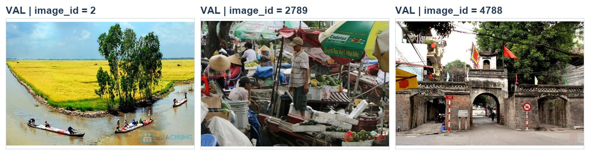
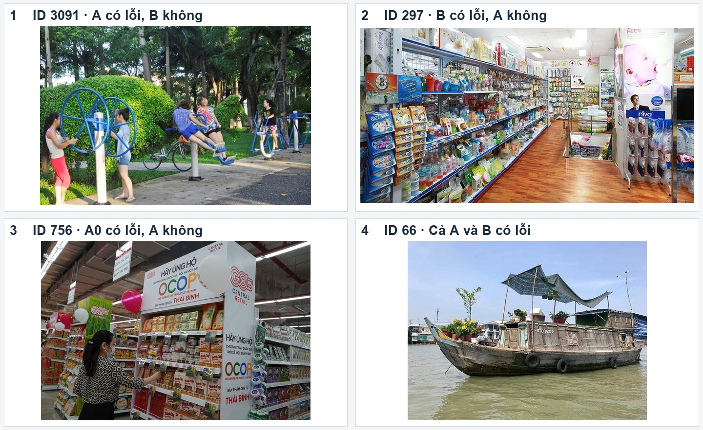

# Đề xuất phiếu chấm lỗi caption

**Vanh và Linh Khánh · Cập nhật 18/11/2026 · Đã đối chiếu và tổng hợp 40 ảnh test.**

Sáu ảnh val dùng để thử tiêu chí ở mục 3. Kết quả của 40 ảnh test nằm ở [mục 7](#7-kết-quả-chấm-test).

## 1. Quyết định của hai thành viên

Phần Vanh dưới đây được điền theo yêu cầu của Vanh. Các ý kiến và nhãn thử của Linh Khánh được giữ theo bản gửi.

| Nội dung | Phương án đề xuất | Vanh | Linh Khánh |
|---|---|---|---|
| Phạm vi | A, B, A0, mỗi mô hình một caption/ảnh trên cùng 40 ảnh test | Đồng ý. Dùng A 512/1120/512 và A0 đã khóa trên val, cùng bản B Kaggle Linh Khánh dùng. Phạm vi hiện tại là ba mô hình. | Đồng ý. Chưa thêm C (CLIP) vì C chưa train; nếu C có output trước khi khóa gói chấm thì thêm làm mô hình thứ tư (100 dòng/người) và sửa mục này trước khi tạo gói. Dùng bản đã khóa: A 512 và B cùng chạy Kaggle, seed 42, chọn theo CIDEr val, greedy tối đa 40 token |
| Tiêu chí | Sáu cờ lỗi ở mục 2, có thể đánh dấu nhiều loại trên một caption | Đồng ý. Phần chấm bổ sung dùng quy tắc về số lượng, dấu hiệu chuyển động, ranh giới và thuộc tính ở mục 2. | Đồng ý sáu cờ. Xin thêm quy tắc cho 4 trường hợp gặp khi chấm thử (cuối mục 3), chủ yếu “có một chiếc X” khi ảnh có nhiều X |
| Tập chấm thử | 6 ảnh val gồm `2, 2789, 4770, 4788, 6000, 9826` | Đồng ý. Đã bổ sung 18 dòng theo đúng ảnh, caption và item ID của Linh Khánh. | Đồng ý. Đã chấm đủ 6 ảnh, 18 dòng (A, B, A0 mỗi ảnh), mục 3 |
| Chọn và chia ảnh test | Seed 42 chọn 40 ID, seed 43 chia 25 ảnh/người với 10 ảnh trùng | Đồng ý. Đã chạy và ghi 40 ID, phần chia và SHA-256 ngay ở mục 4. | Đồng ý. Vanh chạy mã và lưu `selection.json` trước khi ai xem caption test; tôi đối chiếu `test_ids_sha256` với `test_ids.json` của tôi |
| Ẩn mô hình | Trộn caption riêng từng ảnh, mở bảng đối chiếu sau khi khóa phiếu | Đồng ý. Vanh chuẩn bị gói khi có đủ prediction, giữ khóa riêng và ghi rõ giới hạn ẩn danh của người chuẩn bị. | Đồng ý. Người tạo gói (đề xuất Vanh, vì giữ file A và A0) không đưa `blind_key.json` cho người kia; báo cáo ghi rõ người đó có thể đoán được nguồn |
| Chốt nhãn | Chấm riêng, đối chiếu phần trùng rồi thảo luận bất đồng | Đồng ý. Lưu phiếu gốc, giữ `?` khi chưa rõ. Phần chấm thử val cần Linh Khánh rà lại các ô khác nhau ở mục 3. | Đồng ý. Mức thống nhất tính từ hai phiếu gốc trước thảo luận; ô còn `?` sau thảo luận giữ nguyên, không đổi thành `0` |

Đợt test đã lấy đúng ba checkpoint chọn trên val. A dùng epoch 5 (CIDEr 76,96), B Kaggle dùng epoch 6 (72,42), A0 dùng epoch 6 (77,95). Cả ba dùng seed 42, cùng cache ResNet-50 và cùng từ vựng. Sinh greedy tối đa 40 token; mỗi mô hình sinh đủ 40 caption và kết thúc EOS ở cả 40 ảnh.

## 2. Sáu loại lỗi và ví dụ

**Căn cứ chính là ảnh gốc.** Năm câu tham chiếu giúp đối chiếu, không phải danh sách bắt buộc phải kể đủ. Câu ngắn, dùng từ đồng nghĩa hoặc bỏ bớt chi tiết đúng không tự động là lỗi. Không suy đoán tuổi, nghề nghiệp, ý định hoặc hành động khó thấy từ một ảnh tĩnh.



Các câu sai dưới đây **được tự đặt để minh họa**, không phải caption hay lỗi đã đo của mô hình. Ảnh `2` có ba thuyền trên sông; `2789` có người đàn ông đội mũ lưỡi trai đứng giữa ảnh, mặc áo sọc xám; `4788` có hai lá cờ chính phía trên vòm cổng.

| Mã / loại lỗi | Đánh dấu khi | Ví dụ caption sai → căn cứ sửa |
|---|---|---|
| **VT — Vật thể** | Gọi sai hoặc thêm người, con vật, đồ vật không có trong ảnh | Val `2`: “Trong ảnh có ba chiếc **ô tô**” → ba chiếc **thuyền** |
| **HD — Hành động** | Nói sai việc hoặc tư thế của chủ thể đã xác định | Val `2789`: “Người đàn ông đội mũ lưỡi trai ở giữa ảnh đang **ngồi**” → đang **đứng** |
| **QH — Quan hệ** | Sai vị trí tương đối, chủ thể–đối tượng hoặc quan hệ sở hữu có thể thấy rõ | Val `4788`: “Hai lá cờ chính ở **dưới** vòm cổng” → ở **phía trên** |
| **SL — Số lượng** | Khẳng định số đếm sai của một nhóm xác định | Val `2`: “Trên sông có **tổng cộng hai** chiếc thuyền” → thấy **ba** chiếc |
| **BD — Chi tiết bịa** | Thêm thuộc tính/bối cảnh sai hoặc không có căn cứ nhìn thấy, ngoài bốn loại trên | Val `2789`: “Người đàn ông đội mũ lưỡi trai ở giữa ảnh mặc **áo đỏ**” → áo **sọc xám** |
| **LT — Lặp từ** | Lặp từ/cụm/mệnh đề thừa, không bổ sung ý | Val `2`: “Có ba chiếc thuyền, **có ba chiếc thuyền** ở trên sông” → bỏ cụm lặp |

**Tránh tính trùng:** cùng một ý sai chỉ gán loại cụ thể nhất: ô tô thay thuyền → VT; hai thay ba → SL; áo đỏ → BD. Không cộng thêm BD cho chính lỗi VT/HD/QH/SL đó. Nếu có hai ý sai khác nhau, có thể đánh dấu hai loại. Mỗi loại chỉ tính một lần/caption dù xuất hiện nhiều chỗ.

Lặp từ có vai trò ngữ pháp bình thường, như “một người cầm một chiếc ô”, được chấm LT = `0`. Với chi tiết bị che khuất hoặc khó xác định, dùng `?` và ghi lý do.

Quy tắc bổ sung dùng cho phần Vanh và đề nghị áp dụng khi chấm test:

1. **Số lượng.** “Có một chiếc X” có thể đang nói về một chiếc trong nhóm, nên SL = `0`. Chấm SL = `1` khi câu xác định số cho cả nhóm và ảnh cho thấy số khác, ví dụ “chỉ có một” hoặc “tổng cộng hai”.
2. **Chuyển động.** Chấm HD = `1` khi xác định được xe được tả đang đậu. Dùng `?` nếu xe rõ nhất đang đậu nhưng vẫn có xe phù hợp ở xa và chưa rõ trạng thái. Chấp nhận cách tả chuyển động khi tư thế hoặc bối cảnh giao thông trong ảnh ủng hộ.
3. **Vị trí.** Dùng QH cho vị trí của người hoặc đồ vật so với quầy/cửa hàng. Nếu ranh giới rõ và caption đặt đối tượng sai phía, chấm `1`. Nếu khó nhận ra ranh giới, giữ `?`. Dùng BD cho thuộc tính hoặc bối cảnh chung của ảnh khi đó là một ý sai riêng.
4. **Thuộc tính.** Dùng BD cho màu sắc và trang phục sai có thể kiểm tra trên ảnh. Ví dụ ở ID `2789`, người đàn ông đứng giữa ảnh mặc áo sọc trắng xám, còn phần xanh rêu là quần.

## 3. Phiếu chấm dùng trực tiếp

**Một dòng = một caption của một ảnh, do một người chấm.** Phiếu hiện ảnh đủ lớn và nguyên văn caption; mặc định chỉ xem ảnh + caption, có thể mở toàn bộ năm tham chiếu khi cần. Không sửa caption trước khi chấm.

Điền `0` khi chưa phát hiện lỗi, `1` khi có lỗi và `?` khi chưa rõ. Ô `1` hoặc `?` cần ghi cụm liên quan và căn cứ trong ảnh. Sáu số `0` chỉ xác nhận chưa phát hiện sáu loại lỗi trên.

### Phiếu Linh Khánh gửi

Giữ nguyên 18 nhãn và ghi chú của phiếu đề xuất 17/11/2026.

| Người chấm | image_id | item_id ẩn danh | Caption | VT | HD | QH | SL | BD | LT | Cụm sai → bằng chứng/sửa đề xuất |
|---|---:|---|---|:-:|:-:|:-:|:-:|:-:|:-:|---|
| Linh Khánh | 2 | it-96ee50 | có một chiếc thuyền đang di chuyển ở trên mặt nước | 0 | 0 | 0 | ? | 0 | 0 | “một chiếc thuyền” → ảnh có ba thuyền trên sông; chưa rõ có tính là khẳng định số lượng nhóm không (trường hợp 1) |
| Linh Khánh | 2 | it-b8d742 | có một chiếc thuyền chở người xuất hiện ở trên mặt nước | 0 | 0 | 0 | ? | 0 | 0 | “một chiếc thuyền” → ảnh có ba thuyền trên sông (trường hợp 1); thuyền có người ngồi/chèo nên “chở người” đúng |
| Linh Khánh | 2 | it-3fd3a1 | có một chiếc xuồng đang di chuyển ở trên mặt nước | 0 | 0 | 0 | ? | 0 | 0 | “một chiếc xuồng” → như trên, ảnh có ba thuyền (trường hợp 1); “xuồng” coi là từ gần nghĩa, không tính VT |
| Linh Khánh | 2789 | it-9a9596 | có một người đàn ông đang đứng ở trong khu chợ | 0 | 0 | 0 | 0 | 0 | 0 | — |
| Linh Khánh | 2789 | it-8cb7a1 | có một người đàn ông mặc áo xanh đang đứng bên trong quầy hàng | 0 | 0 | 0 | 0 | 1 | 0 | “mặc áo xanh” → người đàn ông đứng giữa ảnh mặc áo sọc trắng xám, quần xanh rêu |
| Linh Khánh | 2789 | it-29502b | có một người phụ nữ đội nón lá đang ngồi ở bên trong quầy hàng | 0 | 0 | 0 | 0 | 0 | 0 | — |
| Linh Khánh | 4770 | it-19602b | có một chiếc xe buýt đang di chuyển ở trên đường | 1 | 0 | 0 | 0 | 0 | 0 | “xe buýt” → xe trắng là ô tô/xe van, không có xe buýt (ảnh có ô tô con và nhiều xe máy). Không cộng SL cho “một chiếc” vì cùng một ý sai |
| Linh Khánh | 4770 | it-1e04f1 | có một chiếc xe ô tô đang di chuyển ở trên đường | 0 | 0 | 0 | ? | 0 | 0 | “một chiếc xe ô tô” → thấy hai ô tô (bạc, trắng) cùng nhiều xe máy (trường hợp 1). Bỏ sót xe máy không phải lỗi |
| Linh Khánh | 4770 | it-0d6134 | có nhiều phương tiện giao thông đang di chuyển ở trên đường | 0 | 0 | 0 | 0 | 0 | 0 | — |
| Linh Khánh | 4788 | it-8de956 | có một chiếc xe máy đang di chuyển ở trên đường | 0 | ? | 0 | 0 | 0 | 0 | “xe máy đang di chuyển” → xe máy rõ nhất ở vòm bên trái có vẻ đang đậu; cuối đường có thể có xe nhưng không rõ (trường hợp 2) |
| Linh Khánh | 4788 | it-808b46 | có một cái cổng thành xuất hiện ở trên con phố | 0 | 0 | 0 | 0 | 0 | 0 | — |
| Linh Khánh | 4788 | it-ff9089 | có một cái cổng thành xuất hiện ở trong bức ảnh | 0 | 0 | 0 | 0 | 0 | 0 | — |
| Linh Khánh | 6000 | it-cc8250 | có nhiều mặt hàng đồ trang trí được bày bán ở trong cửa hàng | 0 | 0 | 0 | 0 | ? | 0 | “ở trong cửa hàng” → ảnh là phố bán đồ trang trí, hàng bày ở hai bên đường và dưới mái che; có cửa hiệu hai bên nên chưa chắc sai (trường hợp 3) |
| Linh Khánh | 6000 | it-167004 | có nhiều loại đồ trang trí được bày bán ở hai bên của con đường | 0 | 0 | 0 | 0 | 0 | 0 | — |
| Linh Khánh | 6000 | it-859fb2 | có nhiều người đang di chuyển ở trên con phố | 0 | 0 | 0 | 0 | 0 | 0 | — |
| Linh Khánh | 9826 | it-3f550e | có nhiều mặt hàng được bày bán ở trong cửa hàng | 0 | 0 | 0 | 0 | 0 | 0 | — |
| Linh Khánh | 9826 | it-131118 | có nhiều mặt hàng được bày bán ở trong cửa hàng | 0 | 0 | 0 | 0 | 0 | 0 | — (cùng nguyên văn với một mục khác của ảnh này, giữ riêng) |
| Linh Khánh | 9826 | it-b873a0 | có một người phụ nữ mặc áo xanh đang đứng bên trong quầy hàng | 0 | 0 | ? | 0 | 1 | 0 | “áo xanh” → người phụ nữ mặc áo vàng, người mặc áo xanh nhạt là đàn ông (BD). “đứng bên trong quầy hàng” → hai người đứng ở phía trước quầy, người bán ngồi phía trong (QH ?, trường hợp 3) |

Theo Linh Khánh, nguồn caption là A 512 trên Kaggle (CIDEr val 76,96), B trên Kaggle seed 42 và A0 (`A0_Uniform/val_predictions.json`, CIDEr val 77,95). Linh Khánh trộn item ID theo từng ảnh và giữ khóa ngoài Git. Hai ảnh `4770` và `9826` từng xuất hiện trong hình so sánh có tên A/A0. Ở bốn ảnh còn lại, caption A0 được thêm sau lượt đầu nên có thể đoán nguồn. Phiếu Linh Khánh là bản nháp có hỗ trợ của Claude Code và cần Linh Khánh xem lại trước khi nộp.

### Phần Vanh

Codex điền theo yêu cầu của Vanh sau khi xem sáu ảnh gốc. Caption giữ nguyên như bảng trên theo từng `item_id`. Hai caption giống hệt nhau ở ID `9826` vẫn là hai mục riêng. Cả 18 caption đã được đối chiếu với đầu ra val đúng phiên bản, gồm sáu caption B khớp dữ liệu lưu trong checkpoint B Kaggle.

| image_id | item_id ẩn danh | VT | HD | QH | SL | BD | LT | Cụm sai → bằng chứng/sửa đề xuất |
|---:|---|:-:|:-:|:-:|:-:|:-:|:-:|---|
| 2 | it-96ee50 | 0 | 0 | 0 | 0 | 0 | 0 | “Một chiếc” chỉ một thuyền trong nhóm. Người chèo và vệt nước phù hợp với chuyển động. |
| 2 | it-b8d742 | 0 | 0 | 0 | 0 | 0 | 0 | Có thuyền chở người. “Một chiếc” giới thiệu một thuyền, không đếm cả nhóm. |
| 2 | it-3fd3a1 | 0 | 0 | 0 | 0 | 0 | 0 | Có xuồng/thuyền nhỏ trên mặt nước. “Một chiếc xuồng” chỉ một chiếc trong nhóm. |
| 2789 | it-9a9596 | 0 | 0 | 0 | 0 | 0 | 0 | Người đàn ông đứng giữa các hàng trong chợ. |
| 2789 | it-8cb7a1 | 0 | 0 | ? | 0 | 1 | 0 | “Áo xanh” → áo sọc trắng xám, quần xanh rêu. “Bên trong quầy” → người đứng giữa các sạp, chưa phân biệt được ranh giới quầy. |
| 2789 | it-29502b | 0 | 0 | ? | 0 | 0 | 0 | Có người đội nón lá ngồi phía trái. “Bên trong quầy hàng” khó xác nhận vì đồ bày che ranh giới. |
| 4770 | it-19602b | 1 | 0 | 0 | 0 | 0 | 0 | “Xe buýt” → xe trắng nhìn rõ có dáng ô tô/van. Ảnh còn có ô tô con và nhiều xe máy. |
| 4770 | it-1e04f1 | 0 | 0 | 0 | 0 | 0 | 0 | Ô tô bạc ở làn đường. “Một chiếc ô tô” có thể tả riêng chiếc đó. |
| 4770 | it-0d6134 | 0 | 0 | 0 | 0 | 0 | 0 | Nhiều xe máy và ô tô đang tham gia giao thông. |
| 4788 | it-8de956 | 0 | ? | 0 | 0 | 0 | 0 | “Xe máy đang di chuyển” → xe rõ nhất dưới vòm trái có vẻ đậu. Các xe ở sâu trong đường khó xác định trạng thái. |
| 4788 | it-808b46 | 0 | 0 | 0 | 0 | 0 | 0 | Cổng thành nằm ngay trên lối đường đi qua. |
| 4788 | it-ff9089 | 0 | 0 | 0 | 0 | 0 | 0 | Cổng thành hiện rõ giữa ảnh. |
| 6000 | it-cc8250 | 0 | 0 | ? | 0 | 0 | 0 | “Ở trong cửa hàng” → hàng nằm sát lối đi và dưới mái che. Chưa xác định được vị trí so với ranh giới cửa hiệu. |
| 6000 | it-167004 | 0 | 0 | 0 | 0 | 0 | 0 | Đồ trang trí bày ở hai bên đường. |
| 6000 | it-859fb2 | 0 | 0 | 0 | 0 | 0 | 0 | Có nhiều người đi giữa các quầy trên phố. |
| 9826 | it-3f550e | 0 | 0 | 0 | 0 | 0 | 0 | Nhiều mặt hàng bày trong cửa hàng và sát mặt tiền. |
| 9826 | it-131118 | 0 | 0 | 0 | 0 | 0 | 0 | Cùng caption với mục trên, giữ riêng và chấm cùng nhãn. |
| 9826 | it-b873a0 | 0 | 0 | 1 | 0 | 1 | 0 | “Áo xanh” → người đứng thẳng ngay giữa ảnh mặc áo vàng. “Bên trong quầy” → người này đứng ở phía khách, trước hàng hóa bày sát lối đi. |

### Đối chiếu bốn trường hợp Linh Khánh nêu

| Trường hợp | Cách xử lý trong phần Vanh |
|---|---|
| “Có một chiếc X” ở ID `2` và `4770` | Cả bốn ô SL là `0`. Ba mục ở ID `2` và một mục ở ID `4770` đều tả một chiếc có trong ảnh. |
| Xe máy có đang chạy ở ID `4788` | Giữ HD = `?` vì xe xa chưa đủ rõ. |
| Ranh giới quầy/cửa hàng | Giữ QH = `?` cho hai mục ở ID `2789` và mục “trong cửa hàng” ở ID `6000`. Riêng ID `9826`, người áo vàng đứng trước quầy nên phần Vanh chấm QH = `1`. Các ô này cần Linh Khánh đối chiếu. |
| Màu áo ở ID `2789` và `9826` | Hai phần cùng chấm BD = `1`. Ví dụ màu áo sọc trắng xám đã được bổ sung vào mục 2. |

Trên 108 ô của phiếu thử, 98 ô có nhãn `0/1` ở cả hai phần và đều trùng nhau. Mười ô còn lại có ít nhất một dấu `?`, trong đó ô HD của `it-8de956` là `?` ở cả hai phần. Phần Vanh được điền sau khi đã có phiếu Linh Khánh, nên số này chỉ dùng để rà tiêu chí. Độ thống nhất khi chấm độc lập sẽ tính từ phiếu test gốc.

## 4. Chọn 40 ảnh test bằng seed

Mẫu dưới đây được lấy theo ID trước khi xem caption test. Đã kiểm tra danh sách nguồn có 558 ID duy nhất. Seed `42` chọn mẫu không hoàn lại và seed `43` chia việc. Giữ đúng 40 ID này khi tạo gói chấm.

| Phần chia | Số ảnh | ID theo thứ tự chia |
|---|---:|---|
| Cả hai | 10 | `245, 2275, 756, 4107, 2705, 630, 6093, 4370, 228, 1719` |
| Chỉ Vanh | 15 | `1191, 10357, 876, 2291, 2058, 2921, 4658, 1004, 363, 4653, 297, 3091, 2586, 306, 4075` |
| Chỉ Linh Khánh | 15 | `11487, 749, 709, 1373, 5197, 6310, 5237, 4145, 3051, 2408, 1674, 66, 832, 3417, 2438` |

`test_ids_sha256 = 514e6930ec10bee1a223444593670f07ab6f2374419b160b38e044c465ec9513` (Python `3.13.7`). Tổng hợp ba hàng và sắp tăng dần để lấy `selected_ids`. Danh sách của mỗi người gồm hàng “Cả hai” rồi tới hàng riêng. Đã xuất `artifacts/manual_caption_review/selection.json` và đối chiếu đúng 40 ID, 25 ảnh mỗi người, trùng 10 ảnh.

```python
import hashlib, json, platform, random
from pathlib import Path

source = Path("data/processed/ktvic/test_ids.json")
raw = source.read_bytes()
ids = sorted(map(int, json.loads(raw)))
assert len(ids) == len(set(ids)) and len(ids) >= 40
selected = sorted(random.Random(42).sample(ids, 40))
order = random.Random(43).sample(selected, 40)
overlap = order[:10]
record = {
    "selection_seed": 42, "assignment_seed": 43,
    "python_version": platform.python_version(),
    "test_ids_sha256": hashlib.sha256(raw).hexdigest(),
    "selected_ids": selected, "overlap_ids": overlap,
    "vanh_ids": overlap + order[10:25],
    "linh_khanh_ids": overlap + order[25:40],
}
out = Path("artifacts/manual_caption_review/selection.json")
out.parent.mkdir(parents=True, exist_ok=True)
out.write_text(json.dumps(record, ensure_ascii=False, indent=2), encoding="utf-8")
```

Đối chiếu kết quả xuất với hash và danh sách trên trước khi dùng. Mỗi người chấm **25 ảnh × 3 caption = 75 dòng**. Hai phiếu có 10 ảnh trùng trong tổng số 40 ảnh. Việc chọn checkpoint và cách sinh câu hoàn tất trên val trước khi mở gói test.

## 5. Ẩn tên mô hình và khóa kết quả

1. Chuẩn bị gói chấm từ cùng 40 ID và ba file prediction đã khóa. Kiểm tra mỗi file có đúng một caption cho từng ID; thiếu, trùng hoặc rỗng thì sửa gói trước khi chấm. Caption giống hệt nhau vẫn giữ thành các mục riêng.
2. Với **từng ảnh**, dùng bộ sinh ngẫu nhiên hệ thống để trộn ba caption độc lập và cấp `item_id` vô nghĩa. Không dùng một nhãn cố định như X = A cho mọi ảnh. Hai người nhận cùng `item_id` và thứ tự caption trên 10 ảnh trùng.
3. Phiếu chỉ chứa ảnh, `image_id`, `item_id`, caption và cột chấm. Bỏ tên mô hình, tên file/run, checkpoint, attention map và điểm BLEU/CIDEr. Không có cột bí mật hoặc cột bị ẩn chứa tên mô hình trong cùng phiếu.
4. Bảng riêng `blind_key.json` giữ `item_id → model, image_id`, hash các file prediction, hash checkpoint và phiên bản phiếu. Để ngoài gói chấm, ngoài Git và nơi chia sẻ phiếu; cả hai thống nhất không mở bảng này khi chấm. Đây là cách giảm thiên kiến; người từng đọc caption có thể vẫn đoán được nguồn.
5. Mỗi người nộp bản phiếu độc lập; lưu nguyên bản trước khi trao đổi. Đối chiếu và chốt bất đồng khi vẫn đang ẩn tên. Sau đó khóa bản kết quả, mới mở bảng đối chiếu để tổng hợp theo A/B/A0.

## 6. Cách tổng hợp và bàn giao

- **Theo mô hình:** báo từng loại lỗi dưới dạng `số caption lỗi / số caption đã chốt` và %. Báo thêm tỷ lệ caption có ít nhất một lỗi. Nhiều loại có thể cùng xuất hiện nên tổng tỷ lệ không cần bằng 100%. Một mô hình có tối đa 40 caption riêng biệt; phần chấm trùng chỉ tính một lần sau thống nhất.
- **Mức thống nhất ban đầu:** trên 10 ảnh trùng × 3 mô hình × 6 loại = **180 ô**. Tính từ hai phiếu gốc trước thảo luận. Báo số ô Codex và Linh Khánh điền giống nhau trên số ô cả hai đã điền `0/1`, kèm số ô có `?` và các loại hay bất đồng. Ghi rõ đây là mức thống nhất giữa một lượt Codex chấm và một lượt Linh Khánh chấm.
- Nếu sau thảo luận vẫn còn `?`, giữ nguyên và báo riêng số chưa rõ; không đổi thành `0`. Mỗi tỷ lệ ghi rõ mẫu số đã chốt của loại đó. Tỷ lệ “ít nhất một lỗi” dùng caption có ít nhất một `1` hoặc cả sáu ô đều `0`.
- **Bốn ví dụ cuối:** sau khi chấm xong, lấy ID nhỏ nhất chưa dùng trong từng nhóm: A có lỗi/B không; B có lỗi/A không; A0 có lỗi/A không; cả A và B có lỗi. Chỉ dùng nhãn đã rõ. Nếu nhóm không còn ID phù hợp, ghi rõ rồi bổ sung ID nhỏ nhất có lỗi chưa dùng; nếu vẫn thiếu thì dùng ID nhỏ nhất còn lại. Mỗi ví dụ có ảnh, ID, caption, cả năm tham chiếu và lời giải thích. Đây là ví dụ trong mẫu 40, không đại diện toàn tập test.
- **Gói bàn giao sau duyệt:** phiên bản phiếu đã chốt, `selection.json`, hai phiếu gốc, phiếu sau thống nhất, bảng tổng hợp và bốn ví dụ; giữ khóa ẩn danh riêng cho đến lúc khóa nhãn. Đây là phân tích mô tả trên 40 ảnh, không đủ để kết luận mô hình vượt trội trên mọi ảnh.

## 7. Kết quả chấm test

### Đối chiếu hai phiếu gốc

Vanh chọn dùng 75 nhãn do Codex chấm. Linh Khánh nộp phiếu riêng có Claude Code hỗ trợ và ghi rằng đã xem lại từng ảnh. Phiếu gửi khớp đủ 25 ảnh, 75 mã mục và nguyên văn caption. Đếm trực tiếp từ từng dòng của phiếu Linh Khánh cho **45 có lỗi, 11 chưa rõ, 19 toàn số 0**. Phần tóm tắt đầu bản gốc ghi 43/14/18. Bản gốc được giữ nguyên.

Trên **30 caption của 10 ảnh chung**, hai phiếu trùng **168/172 ô có nhãn `0/1` (97,67%)**. Có 4 ô khác nhau và 8 ô cả hai cùng ghi `?`. Codex xử lý 4 ô bằng cách xem lại ảnh gốc khi tên mô hình còn ẩn, rồi khóa đủ 120 dòng trước khi mở bảng khóa. Đây là mức trùng giữa lượt Codex chấm và lượt Linh Khánh chấm, có hỗ trợ AI.

| Ảnh | Ô khác nhau, Codex / Linh Khánh | Nhãn dùng và căn cứ |
|---:|---|---|
| 228 | QH 1/0, BD 0/1 | **QH = 1, BD = 0.** Hoa ở mái hiên, giỏ xe trống. “Xe đạp chở hoa” gán sai quan hệ giữa xe và hoa. HD giữ `?` vì ảnh tĩnh chưa rõ xe đang chạy. |
| 2275 | BD 0/1 | **BD = 1.** “Quầy bán đồ trang sức” là ý sai riêng, vì kệ phía sau bày hộp và giỏ quà. VT vẫn là 1 cho chủ thể sai. |
| 4107 | VT 1/0 | **VT = 0, BD = 1.** Quầy và người đều xuất hiện. Caption tả sai loại hàng và màu áo, tính một lần theo BD. |

### Tỷ lệ lỗi theo mô hình

Mỗi mô hình có 40 caption trên cùng 40 ảnh. Mỗi ô ghi số có lỗi / số đã rõ, tỷ lệ và số ô `?`. Với dòng tổng, caption có ít nhất một cờ `1` đã được tính là có lỗi dù một cờ khác còn `?`. Nếu chưa có cờ `1` và còn `?`, caption vẫn là chưa rõ.

| Loại lỗi | A | B | A0 |
|---|---:|---:|---:|
| VT · Vật thể | 7/37 (18,92%) · 3 ? | 10/38 (26,32%) · 2 ? | 9/36 (25,00%) · 4 ? |
| HD · Hành động | 5/36 (13,89%) · 4 ? | 6/38 (15,79%) · 2 ? | 3/34 (8,82%) · 6 ? |
| QH · Quan hệ | 2/38 (5,26%) · 2 ? | 7/38 (18,42%) · 2 ? | 2/39 (5,13%) · 1 ? |
| SL · Số lượng | 0/40 (0,00%) · 0 ? | 0/40 (0,00%) · 0 ? | 1/40 (2,50%) · 0 ? |
| BD · Chi tiết bịa | 11/40 (27,50%) · 0 ? | 6/39 (15,38%) · 1 ? | 8/40 (20,00%) · 0 ? |
| LT · Lặp từ | 0/40 (0,00%) · 0 ? | 1/40 (2,50%) · 0 ? | 0/40 (0,00%) · 0 ? |
| **Có ít nhất một lỗi** | **20/34 (58,82%) · 6 ?** | **24/34 (70,59%) · 6 ?** | **23/33 (69,70%) · 7 ?** |

Trong mẫu này, A có tỷ lệ caption lỗi thấp nhất trong các caption đã rõ, nhưng có nhiều cờ BD nhất. B có nhiều cờ QH nhất. Mỗi mô hình chỉ có 40 caption của một checkpoint, với cách chấm nêu trên. Kết quả mô tả mẫu test này.

### Bốn ảnh minh họa

Chọn ID nhỏ nhất chưa dùng trong từng nhóm đã định ở mục 6. Bốn nhóm đều có ảnh phù hợp.



<details>
<summary>1. Ảnh 3091 · A có lỗi, B không</summary>

| Mô hình | Caption | Cờ lỗi |
|---|---|---|
| A | có một nhóm người đang chụp ảnh tập thể dục ở trên đường | HD |
| B | có một nhóm người đang tụ tập ở trên đường | 0 |
| A0 | có một nhóm người đang chụp ảnh tập thể dục | HD |

Nhóm người đang sử dụng dụng cụ tập ngoài trời. A và A0 tả sai hành động khi nói đang chụp ảnh. B dùng cách mô tả chung và phiếu không ghi nhận lỗi ở câu đó.

**Năm câu tham chiếu**

- nhiều người đang tập thể dục ở trong công viên
- nhiều người đang vận động ở bên trong công viên
- có một nhóm người đang tập thể dục ở ngoài trời
- ở ngoài trời có một vài người đang tập thể dục
- có một nhóm người đang sử dụng những dụng cụ tập thể dục

</details>

<details>
<summary>2. Ảnh 297 · B có lỗi, A không</summary>

| Mô hình | Caption | Cờ lỗi |
|---|---|---|
| A | có nhiều loại hàng hoá đang được bày bán ở trên các kệ hàng | 0 |
| B | có một vài người đang đứng ở bên trong siêu thị | VT |
| A0 | có nhiều mặt hàng được bày bán ở trên các kệ hàng | 0 |

Lối đi trong cửa hàng trống. Các khuôn mặt nhìn thấy nằm trên ảnh quảng cáo, nên B sai khi thêm người đang đứng. A và A0 tả các kệ hàng có trong ảnh.

**Năm câu tham chiếu**

- có nhiều mặt hàng được bày bán trong cửa hàng
- có nhiều loại hàng hoá được bày bán trong cửa hàng
- có nhiều loại hàng hoá xuất hiện ở trong cửa hàng
- ở trong cửa hàng có sự xuất hiện của nhiều loại hàng hoá
- có nhiều loại hàng hoá được bày ra trên các kệ hàng

</details>

<details>
<summary>3. Ảnh 756 · A0 có lỗi, A không</summary>

| Mô hình | Caption | Cờ lỗi |
|---|---|---|
| A | có một người phụ nữ mặc áo đen đang đứng bên một quầy hàng bán bánh kẹo | 0 |
| B | có một người đàn ông đang đứng ở bên quầy hàng | VT |
| A0 | có một người phụ nữ mặc áo xanh đang đứng bên một quầy hàng | BD |

Người ở quầy mặc áo nền đen có họa tiết sáng. A0 tả áo xanh nên bị đánh dấu BD. B gọi người này là đàn ông nên bị đánh dấu VT.

**Năm câu tham chiếu**

- một người phụ nữ đang đứng trước một kệ hàng
- một người phụ nữ đang chạm tay vào một sản phẩm trên kệ hàng
- một người phụ nữ đang lựa chọn sản phẩm trên kệ hàng
- ở trước kệ hàng có một người phụ nữ đang lựa hàng hoá
- ở trước kệ hàng có sự xuất hiện của một người phụ nữ

</details>

<details>
<summary>4. Ảnh 66 · Cả A và B có lỗi</summary>

| Mô hình | Caption | Cờ lỗi |
|---|---|---|
| A | có một con thuyền đang di chuyển ở trên mặt nước | HD |
| B | có một con thuyền đang di chuyển ở trên mặt nước | HD |
| A0 | có một chiếc thuyền chở người xuất hiện ở trên mặt nước | VT |

A và B sinh cùng một câu. Phiếu Linh Khánh chấm HD cho “đang di chuyển” vì thấy dây neo trước mũi thuyền. A0 nói thuyền chở người, trong khi phần nhìn rõ trên thuyền là các chậu cây cảnh.

**Năm câu tham chiếu**

- có một con tàu xuất hiện ở trên mặt nước
- có những chậu cây cảnh xuất hiện ở trên con tàu
- có những chậu cây cảnh được chở ở trên con tàu
- ở trên mặt nước có một con tàu đang chở theo những chậu cây cảnh
- ở trên sông có sự xuất hiện của một con tàu chở cây cảnh

</details>

### Nơi lưu phiếu và đầu ra

- Bản gốc Linh Khánh và 25 ảnh từ bản xuất nằm ở `artifacts/manual_caption_review/linh_khanh/submitted/`. Bản JSON nhập nhãn nằm ở `linh_khanh/labels_linh_khanh_submitted.json` tính từ thư mục chấm. Phiếu gốc Codex nằm ở `vanh/labels_vanh_locked.json`.
- Phiếu Markdown đủ 120 dòng, bản JSON đã khóa, bảng đối chiếu 30 mục chung và tổng hợp theo mô hình nằm ở `artifacts/manual_caption_review/final/`. Đã kiểm tra hash của ba checkpoint và ba tập prediction. Các file gốc, ảnh đầy đủ và bảng khóa nằm ngoài Git.
- B dùng checkpoint `artifacts/checkpoints/ktvic/B_kaggle_seed42/best.pt`, epoch 6 với CIDEr val 72,42. Caption val trích từ checkpoint nằm ở `runs/transformer_b_kaggle_seed42/val_predictions.json`. JSON gửi kèm thuộc lượt RTX 2050, CIDEr val 70,47, và được lưu tại `runs/transformer_b_rtx2050_seed42/val_predictions.json`.
